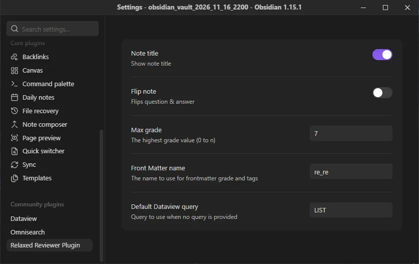

# Relaxed Reviewer

A plugin for reviewing and grading your Obsidian notes.

> **Note:** This plugin is a work in progress. Expect bugs and messy code! I built it because I couldn't find an existing solution that met my needs.

## Requirements

- [Dataview](https://github.com/blacksmithgu/obsidian-dataview)
- [Omnisearch](https://github.com/scambier/obsidian-omnisearch)

## Commands

The plugin adds three commands, accessible via `Ctrl/Cmd + P`:

- **Dataview query** – Run a Dataview query.
- **Omnisearch search** – Search using Omnisearch.
- **Reset session** – Reset the current review session.

## Features

### Search & Navigation

- Run Dataview queries or Omnisearch searches.
- Search results appear in the left panel.
- Dataview and Omnisearch search the entire vault if no previous search results are available. Otherwise, they filter the current result list.
- Use the **Reset session** command to start a new search across the entire vault.
- Submitting an empty query runs the default query specified in the settings.
- Click any note to open it, then use the **Previous/Next** buttons to navigate through the results.

### Grading

- Each note displays 8 grading buttons (configurable in the settings).
- Grades are saved as a note property (configurable in the settings).
- Previously graded notes have their corresponding grade button highlighted.
- Grading a note automatically updates its modification date.

### Note Content

- **Hide title** – Useful when the title might reveal the answer.
- **Hide content** – Use `%%??%%` in your note to hide everything after the separator.
- A **Show Answer** button appears when a note contains a hidden section. Clicking it reveals the answer and enables grading.
- After grading a note, the plugin automatically advances to the next one.
- The question and answer can be swapped through the settings.

### Review Sessions

- Each review session gets a unique ID when a new query is executed.
- Notes are automatically assigned the current session ID when opened during a review session.
- The session ID is saved as a note property (frontmatter), making it possible to identify which session a note belongs to.
- You can use the session ID in a Dataview query to retrieve all notes opened during a particular session, allowing you to review the same set of notes again later.
- Use the **Reset session** command to clear the current session and start a fresh search.

## Example Dataview Queries

```dataview
TABLE // Shows all notes in the vault
LIST // Same as above - LIST and TABLE can be used almost interchangeably
LIST FROM "folder"
LIST FROM #tag
LIST FROM "folder" AND (#tag OR #tag)
LIST WHERE property = "value"
LIST WHERE file.mtime >= date(today) - dur(1 week) // Notes modified in the last week
LIST SORT file.ctime ASC // Order by creation time
LIST LIMIT 100
LIST FROM [[note]] // Notes that link to the target note
LIST FROM outgoing([[note]]) // Notes linked within the target note
LIST WHERE contains(file.outlinks, [[note]]) // Same as above, but as a filter
LIST FROM "math" AND (#algebra OR #geometry) WHERE simple_reviewer = 7 OR simple_reviewer = 6 AND file.mtime >= date(today) - dur(1 week) SORT file.ctime ASC // Complex query example
```

## Screenshots



