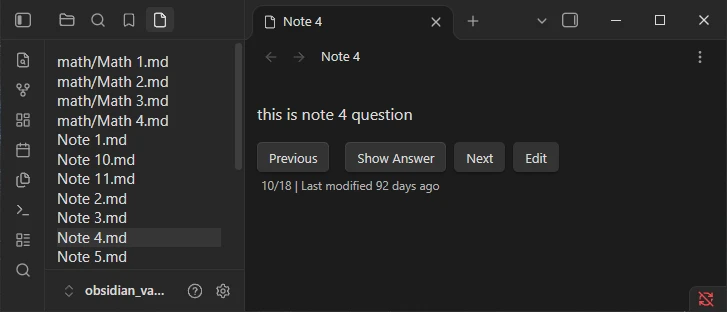
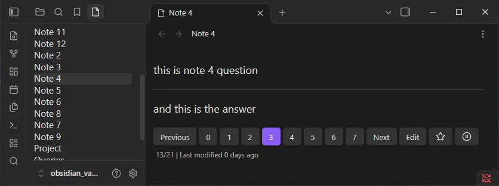

# Relaxed Reviewer

A plugin to review and grade your Obsidian notes.

> **Note:** This plugin is a work in progress. Expect bugs and messy code - I built it because I couldn't find an existing solution that fit my needs.

## Requirements

- [Dataview](https://github.com/blacksmithgu/obsidian-dataview)
- [Omnisearch](https://github.com/scambier/obsidian-omnisearch)

## Commands

The plugin adds three commands (accessible via `Ctrl/Cmd + P`):

- **Dataview query** – Execute a Dataview query
- **Omnisearch search** – Perform an Omnisearch search
- **Reset session** - Reset the review session

## Features

### Search & Navigation

- Run Dataview queries or Omnisearch searches
- Results appear in the left panel
- Dataview and Omnisearch search the entire vault if no results exist, or filter against the current result list if available
- Execute the Reset session command if you want to search the entire vault again
- Click any note to open it, and use **Previous/Next** buttons to navigate the list

### Grading

- Each note displays 8 grade buttons (0–7)
- Grades are saved as a note property: `relaxed_reviewer`
- Already-graded notes show the corresponding button highlighted
- Grading automatically updates the note's modification date

### Note Content

- **Hide title** – Useful when the title might reveal the answer _(TODO)_
- **Hide content** – Use `%%??%%` in your note to hide everything after that point
- A **Show Answer** button appears for hidden sections; clicking it reveals the content and enables grading
- After grading, the view automatically advances to the next note

### Custom Suggestions

- Save your frequently used Dataview queries and Omnisearch keywords _(TODO)_
- They'll appear as suggestions in the search modals

## Example Dataview Queries

```dataview
TABLE // Shows all notes in the vault
LIST // Same as above - LIST and TABLE can be used almost interchangeably
LIST FROM "folder"
LIST FROM #tag
LIST FROM "folder" AND (#tag OR #tag)
LIST WHERE property = "value"
LIST WHERE file.mtime >= date(today) - dur(1 week) // Notes modified in the last week
LIST SORT file.ctime ASC // Order by creation time
LIST LIMIT 100
LIST FROM [[note]] // Notes that link to the target note
LIST FROM outgoing([[note]]) // Notes linked within the target note
LIST WHERE contains(file.outlinks, [[note]]) // Same as above, but as a filter
LIST FROM "math" AND (#algebra OR #geometry) WHERE simple_reviewer = 7 OR simple_reviewer = 6 AND file.mtime >= date(today) - dur(1 week) SORT file.ctime ASC // Complex query example
```

## Screenshots




